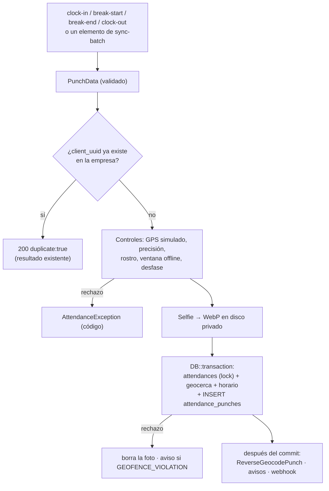

# Integridad de la marcación, geocodificación y push

Cómo se registra cada marcación de forma verificable (bitácora inmutable, idempotencia,
motivos de sospecha, sincronización offline en lote), cómo se obtienen direcciones
(Nominatim / Google) y cómo salen las notificaciones push (FCM). El contrato HTTP exacto está en
[mobile-endpoints.md](../api/mobile-endpoints.md#marcación).

Archivos clave:

| Qué | Dónde |
|---|---|
| Punto de entrada único | `app/Modules/Attendance/Services/AttendanceService.php` (`punch()`) |
| Datos de una marcación / resultado | `app/Modules/Attendance/Services/Attendance/PunchData.php`, `PunchResult.php` |
| Selfies (WebP sin EXIF, miniatura, huella) | `app/Modules/Attendance/Services/Attendance/SelfieStorage.php` |
| Avisos fuera de horario / geocerca | `app/Modules/Attendance/Services/Attendance/AttendanceAlertNotifier.php`, `app/Modules/Attendance/Notifications/AttendanceOutside*.php` |
| Bitácora | `app/Modules/Attendance/Models/AttendancePunch.php`, migración `2026_10_14_000001_create_attendance_punches_table.php` |
| Resumen en la jornada | migración `2026_10_14_000002_add_integrity_columns_to_attendances_table.php` |
| Políticas en Marca y app | migración `2026_10_14_000003_add_attendance_policies_to_tenant_settings_table.php`, `TenantSetting`, `TenantSettingsService` |
| Rutas | `Api\AttendanceController` (4 rutas), `Api\AttendanceSyncController` (lote), `GeocodeController` |
| Geocodificación | `app/Modules/Integrations/Services/Geocoding/*`, job `app/Modules/Attendance/Jobs/ReverseGeocodePunch.php` |
| Push | `app/Modules/Integrations/Services/Push/FcmSender.php`, `app/Modules/Integrations/Notifications/Channels/FcmChannel.php`, job `app/Modules/Integrations/Jobs/SendPushNotification.php` |
| Pruebas | `tests/Feature/AttendancePunchLogTest.php`, `AttendanceSyncBatchTest.php`, `GeocodingTest.php`, `FcmPushTest.php`, `tests/Unit/HaversineEdgeCasesTest.php` |

## Flujo de una marcación

- La jornada se lee con `lockForUpdate()`; el índice único de `attendances`
  (`user_id, branch_id, work_date`) y el de la bitácora (`tenant_id, client_uuid`) cierran las
  carreras: si dos peticiones con el mismo `client_uuid` llegan a la vez, la segunda devuelve el
  resultado de la primera (`duplicate: true`).
- Si la empresa tenía una fila del día sin entrada (p. ej. una falta que marcó
  `attendance:mark-absences`), la entrada la completa en vez de chocar con el índice único.
- Una foto guardada se borra si la transacción falla.

## Bitácora `attendance_punches`

Una fila por evento, **nunca se edita ni se borra**:

| Columna | Detalle |
|---|---|
| `tenant_id`, `attendance_id`, `user_id`, `branch_id` | `branch_id` es la sucursal de la jornada |
| `type` | `clock_in`, `break_start`, `break_end`, `clock_out` |
| `client_uuid` | UUID de la app, único por empresa (nullable) |
| `latitude`, `longitude`, `accuracy_meters` | lo que mandó el teléfono |
| `distance_meters`, `within_geofence` | Haversine contra la sucursal (también en descansos, informativo) |
| `address` | dirección (geocodificación inversa, se completa después) |
| `device_time` | UTC, reloj del teléfono en la marcación |
| `server_time` | UTC, llegada al servidor |
| `time_drift_seconds` | teléfono − servidor (ver abajo) |
| `offline`, `offline_recorded_at` | marcación hecha sin conexión y su hora real (UTC) |
| `photo_path` | disco `ATTENDANCE_DISK` (privado); URL firmada `/secure-files/punch-photo/{id}` |
| `face_detected` | lo que informó la app (nullable) |
| `mock_location_detected` | `is_mocked` del teléfono |
| `suspicious`, `suspicion_reasons` | motivos: `MOCK_LOCATION`, `TIME_DRIFT`, `FACE_UNVERIFIED`, `OUT_OF_GEOFENCE`, `GEOFENCE_EDGE`, `OUTSIDE_SCHEDULE`, `UNSAFE_DEVICE`, `IMPOSSIBLE_TRAVEL`, `REPEATED_COORDINATES`, `STALE_PHOTO` |
| `device_id`, `device_os`, `app_version`, `ip` | metadatos |
| `created_at` | solo creación (`UPDATED_AT = null`) |

**Inmutabilidad en dos capas:**

1. Modelo (`AttendancePunch::booted`): los eventos `updating` y `deleting` lanzan
   `LogicException`.
2. Base de datos: trigger `attendance_punches_immutable` (SQLite, MySQL/MariaDB y PostgreSQL) que
   aborta cualquier `UPDATE` que cambie una columna distinta de `address`, aunque se use el query
   builder. No hay trigger de `DELETE` para que el borrado en cascada de una empresa funcione.

La única escritura permitida es `AttendancePunch::fillAddress($id, $address)`: query builder,
solo si `address` sigue vacía (nunca reemplaza una dirección).

**Resumen en `attendances`** (para listados sin unir la bitácora): `clock_in_accuracy_meters`,
`clock_out_accuracy_meters`, `clock_in_device_time`, `clock_out_device_time` (UTC),
`clock_in_time_drift_seconds`, `clock_out_time_drift_seconds`, `clock_in_mock_location`,
`clock_out_mock_location`, `clock_in_face_detected`, `clock_out_face_detected` e `is_suspicious`
(verdadero si cualquier evento del día fue sospechoso). Los motivos de entrada/salida también
quedan en `clock_in_meta.suspicion_reasons` / `clock_out_meta.suspicion_reasons`. El visor de
evidencia (`AttendanceEvidence::detail`, `GET /api/admin/attendance/{id}`) devuelve estos datos y
la lista `punches`.

### Horas y zonas

- Las columnas `*_at` de `attendances` siguen guardando la **hora de pared de la empresa**.
- `device_time`, `server_time`, `offline_recorded_at` (bitácora) y `*_device_time` (jornada) se
  guardan **en UTC** con el cast `App\Modules\Core\Casts\UtcDateTime`, que también los lee en UTC aunque
  `APP_TIMEZONE` sea otra.
- **Desfase** (`time_drift_seconds`): en una marcación en línea, `device_sent_at − server_time`
  (`device_time − server_time` con apps que no mandan `device_sent_at`).
  En una offline `device_time` es de horas atrás, así que se mide con `device_sent_at` (reloj del
  teléfono al enviar, raíz de `sync-batch` o campo de la ruta individual); sin él queda `null`.
  Más de `max_time_drift_seconds` → motivo `TIME_DRIFT`. Nunca se rechaza por desfase.

## Políticas (Marca y app)

| Columna (`tenant_settings`) | Valores | Por defecto | Efecto |
|---|---|---|---|
| `mock_location_policy` | `reject` \| `flag` | `reject` (o `flag` si `ATTENDANCE_REJECT_MOCK_LOCATION=false` y nadie la definió) | `reject` → `422 MOCK_LOCATION_DETECTED`; `flag` → acepta con `MOCK_LOCATION` |
| `max_time_drift_seconds` | 30..86400 | 300 | umbral de `TIME_DRIFT` |
| `face_detection_required` (existente) | bool | `false` | `face_detected=false` → `422 FACE_NOT_DETECTED`; ausente → `FACE_UNVERIFIED` |
| `company_configurations.geofence_policy` (existente) | `reject` \| `flag` | `reject` | `flag` → acepta con `OUT_OF_GEOFENCE` |
| `branches.geofence_policy` | `reject` \| `flag` \| vacío | vacío | vacío = la de la empresa |
| `branches.geofence_tolerance_meters` | 0–100 | 15 | margen de la zona de borde (`GEOFENCE_EDGE`) |
| `branches.max_gps_accuracy_meters` | 5–500 \| vacío | vacío | vacío = la de la empresa |

Fuera de horario: ventana `[inicio − tolerancia, fin + tolerancia]` del turno de ese día
(`shifts.grace_period_minutes`; si `end ≤ start` o `crosses_midnight`, el fin es al día
siguiente). Tener turnos asignados pero ninguno ese día (descanso) también cuenta. Se evalúa en
entrada y salida; la salida usa el turno guardado en la jornada.

## Selfies: recodificadas, con huella y retención

`SelfieStorage::store()` **siempre** vuelve a codificar la foto con GD, así nunca se guardan los
metadatos del teléfono (EXIF con GPS, modelo, hora): WebP calidad 80 si GD trae `imagewebp`, si no
JPEG (y un aviso en el log por día). Lado mayor máximo 1280 px (no agranda), respeta la orientación
EXIF. Ruta: `photos/{tenant}/{user}/{tipo}/{YYYY}/{MM}/{YmdHis}_{user}_{aleatorio}.webp`, con una
miniatura de 160 px al lado (`…_t.webp`) que usan los listados (`attendance_photo_thumb_url()`,
ruta firmada `selfie-in-thumb` / `selfie-out-thumb`; si falta, se sirve la foto completa). Una foto
que GD no puede leer se rechaza con `PHOTO_UNREADABLE`.

- **Huella:** `attendance_punches.photo_sha256` (SHA-256 del archivo guardado). El trigger de
  inmutabilidad la protege igual que `photo_path`.
- **Foto vieja:** `STALE_PHOTO` si en línea pasaron más de 2 min entre la selfie (`device_time`) y el
  envío (`device_sent_at`).
- **Quién la ve:** abrir la evidencia o el detalle de la jornada de otra persona deja
  `attendance.photo_viewed` en auditoría (una vez por hora y persona). Las miniaturas de los
  listados no cuentan.
- **Evidencia alterada:** al abrir la evidencia o el detalle, `AttendanceEvidence::photoIntegrity()`
  vuelve a calcular el SHA-256 del archivo y lo compara con `photo_sha256`. Si no coincide
  (`altered`) o falta el archivo (`missing`), el panel muestra «Evidencia alterada» y se audita
  `attendance.evidence_altered` (una vez al día por marcación). Las fotos anteriores a la Fase 2
  (sin huella) y las borradas por retención no se evalúan.
- **Retención:** `attendance:purge-photos` (diario 03:45, `--months=12`, `--dry-run`) borra foto y
  miniatura, marca `photo_purged_at` en la bitácora (ruta y huella se conservan como constancia),
  vacía `clock_in_photo` / `clock_out_photo` en `attendances` y audita `attendance.photos_purged`
  por empresa.

## Sincronización en lote

`POST /api/v1/attendances/sync-batch` (`AttendanceSyncController`): máx. 50 elementos, orden
cronológico (`offline_recorded_at` → `device_time` → llegada; empate por tipo), cada uno con
`AttendanceService::punch()` en su propia transacción. Un rechazo (`AttendanceException`,
validación o error inesperado) solo afecta a ese elemento. Respuesta en el orden enviado con
`created` / `duplicate` / `rejected`. Contrato en
[mobile-endpoints.md](../api/mobile-endpoints.md#post-apiv1attendancessync-batch).

## Geocodificación

`App\Modules\Integrations\Services\Geocoding\GeocodingService`:

- `search(string $query, int $limit = 5)` → `[{label, lat, lng}]`.
- `reverse(float $lat, float $lng)` → `{address, provider}` (`address` null si no hay resultado).
- `forTenant(?Tenant)` para usarlo fuera de una request (jobs). Sin empresa (vista global del
  Super Admin, consola) usa la fila de la plataforma.

Proveedor: `geocoding_provider` efectivo (empresa → plataforma → `nominatim`). **Google solo si
está elegido y hay `google_maps_api_key`** (columna cifrada `maps_api_key`, heredable); si no,
Nominatim. Si Google falla (clave inválida, cuota, red) se usa Nominatim y queda en el log.

| Proveedor | Detalle |
|---|---|
| Nominatim (`NominatimGeocoder`) | `https://nominatim.openstreetmap.org` (`NOMINATIM_URL`), `User-Agent: TuneSA/1.0 (+APP_URL)`, `accept-language=es`, `countrycodes` opcional (`NOMINATIM_COUNTRYCODES`, p. ej. `pe`), `email` opcional (`NOMINATIM_EMAIL`). **1 petición por segundo para toda la instalación** (`NOMINATIM_MIN_INTERVAL_MS`, 1000): un candado de caché serializa y espera lo que falte. Usa el store de caché por defecto: con varios servidores debe ser compartido (database/redis). |
| Google (`GoogleGeocoder`) | `https://maps.googleapis.com/maps/api/geocode/json` con `key`, `language=es`; `ZERO_RESULTS` = sin resultado; otro `status` = error (y respaldo a Nominatim). |

Caché (store por defecto): reverse **30 días** por coordenadas redondeadas a 5 decimales (~1 m),
search **1 día** por texto normalizado; claves separadas por proveedor. No se cachean errores ni
reverse vacíos.

Endpoints: panel `GET /geocode/search?q=&limit=` y `GET /geocode/reverse?lat=&lng=` (sesión,
cualquier usuario del panel, `throttle:60,1`); API `GET /api/geocode/reverse?lat=&lng=` (token).
Respuestas `{"success":true,"data":[...]}` / `{"success":true,"data":{"address","provider"}}`;
proveedor caído → `503 GEOCODING_UNAVAILABLE`.

`ReverseGeocodePunch` (cola, 3 intentos con esperas de 30 s y 120 s) completa
`attendance_punches.address` después del commit de cada marcación. Con la cola `sync` corre en la
misma petición y un fallo solo queda en el log (nunca tumba la marcación).

## Push (FCM)

`App\Modules\Integrations\Services\Push\FcmSender` (API HTTP v1):

1. Lee la cuenta de servicio de la **fila global** (`fcm_service_account_json`, cifrada; la
   plataforma es dueña de la única app). Valida `project_id`, `client_email`, `private_key`.
2. Firma un JWT RS256 (`openssl_sign`) con `iss = client_email`,
   `scope = https://www.googleapis.com/auth/firebase.messaging`, `aud = token_uri`, `exp = iat + 3600`
   y lo canjea en `https://oauth2.googleapis.com/token` (`grant_type=urn:ietf:params:oauth:grant-type:jwt-bearer`).
   El access token se cachea ~55 min (`expires_in − 300`). Un `401` de FCM lo renueva una vez.
3. `POST https://fcm.googleapis.com/v1/projects/{project_id}/messages:send` con `token`,
   `notification {title, body}`, `data` (strings), `android.priority=high` + canal
   `FCM_ANDROID_CHANNEL_ID` (`tunesa_default`) y `apns-priority: 10`.
4. `404` o `errorCode: UNREGISTERED` → borra `users.fcm_token` (solo si sigue siendo ese token).
5. `send()` devuelve `PushResult` (`ok`, `status`, `ms`, `response`, `error`, `transient`,
   `tokenCleared`, `code`); nunca lanza por errores de Google.

`FcmSender::test(User $to)` → `{ok, status, ms, response}` o `{ok, status, ms, error, code}`
(`FCM_NOT_CONFIGURED`, `NO_DEVICE_TOKEN`, `UNREGISTERED`, o el `status` de FCM). No mira
`fcm_enabled`, para probar antes de activarlo. Lo usa el botón "Probar push" del panel
(`POST /settings/branding/test-push`).

**Avisos → push.** `AppNotification::via()` agrega `FcmChannel` cuando
`FcmSender::canSendTo($user)`: el usuario tiene `fcm_token` y su empresa tiene `fcm_enabled`
efectivo (empresa → plataforma → `false`) con credenciales válidas en la plataforma. Así **todos**
los avisos in-app existentes (solicitudes, justificaciones, documentos, boletas) y los nuevos
`attendance.outside_schedule` / `attendance.outside_geofence` también salen por push.
`withoutPush()` lo evita (copias para el supervisor). `FcmChannel` no llama a Google en la petición:
encola `SendPushNotification` (después del commit; 3 intentos ante red/429/5xx).

Avisos de asistencia (`AttendanceAlertNotifier`): al colaborador in-app + push, al supervisor de
la sucursal (`branches.supervisor_id`, si no es el mismo colaborador) solo in-app. Los rechazos
por geocerca se avisan como máximo una vez cada 10 minutos por persona y tipo de marcación.

### Push FCM: puesta en marcha

1. En [Firebase console](https://console.firebase.google.com) crear (o usar) el proyecto de la app
   y registrar la app Android (package de `mobile/`) y la app iOS (bundle id). Para iOS, subir la
   clave APNs (`.p8`) en *Configuración del proyecto → Cloud Messaging*.
2. *Configuración del proyecto → Cuentas de servicio → Generar nueva clave privada*: descarga un
   JSON (`type: service_account`, `project_id`, `client_email`, `private_key`, …). La cuenta
   necesita el rol *Firebase Cloud Messaging API Admin* (la de Firebase Admin SDK ya lo tiene) y
   la API "Firebase Cloud Messaging API (V1)" habilitada en Google Cloud.
3. Panel → Super Admin en la **vista global** → *Marca y app → Integraciones*: pegar el JSON en
   `fcm_service_account_json` (o subir el archivo en `fcm_service_account_file`) y activar
   `fcm_enabled`. Se guarda cifrado con `APP_KEY`; solo se muestran `fcm_project_id` y
   `fcm_client_email`. Cada empresa puede apagar o encender push con su propio `fcm_enabled`
   (vacío = heredar).
4. Probar con el botón "Probar push" de la misma pestaña (`POST /settings/branding/push-test`,
   usa `FcmSender::test`) sobre un usuario que ya inició sesión en la app (correo vacío = uno
   mismo; en una empresa solo se buscan sus usuarios). Funciona aunque `fcm_enabled` esté apagado y
   queda en auditoría como `push.tested` (resultado, estado HTTP y latencia).
5. App móvil: compilar con los `--dart-define` de Firebase:
   `FIREBASE_API_KEY`, `FIREBASE_APP_ID`, `FIREBASE_MESSAGING_SENDER_ID`, `FIREBASE_PROJECT_ID`,
   `FIREBASE_IOS_APP_ID`, `FIREBASE_IOS_BUNDLE_ID` (valores de *Configuración del proyecto → Tus
   apps*). La app crea el canal Android `tunesa_default`, pide permiso de notificaciones si
   `mobile.fcm_enabled` es `true` y envía su token en el login (`fcm_token`) y con
   `POST /api/auth/refresh-fcm` cada vez que Firebase lo renueve.
6. Producción: un worker de colas (`php artisan queue:work`) para `SendPushNotification` y
   `ReverseGeocodePunch`.

## Variables de entorno nuevas

| Variable | Por defecto | Uso |
|---|---|---|
| `NOMINATIM_URL` | `https://nominatim.openstreetmap.org` | Servidor Nominatim (puede ser uno propio) |
| `NOMINATIM_COUNTRYCODES` | — | Limitar búsquedas (p. ej. `pe`) |
| `NOMINATIM_EMAIL` | — | Contacto que pide la política de uso |
| `NOMINATIM_MIN_INTERVAL_MS` | `1000` | Espera mínima entre peticiones (0 en las pruebas) |
| `NOMINATIM_TIMEOUT` / `GOOGLE_GEOCODING_TIMEOUT` | `8` | Segundos |
| `FCM_ANDROID_CHANNEL_ID` | `tunesa_default` | Canal de notificaciones Android |
| `ATTENDANCE_REJECT_MOCK_LOCATION` (existente) | `true` | Respaldo de `mock_location_policy` |

Las pruebas nunca salen a internet: `tests/TestCase.php` activa `Http::preventStrayRequests()` y
cada prueba simula Nominatim, Google y FCM con `Http::fake()`.

## Calendario con semáforo

Asistencia > Calendario (`/attendance-calendar`, `CalendarWebController`) muestra la matriz mensual:
una fila por colaborador, una celda por día y los totales del mes (faltas, tardanzas, minutos tarde,
horas). La ven RRHH (`attendance.view_all`, toda la empresa) y supervisores (`attendance.view_team`,
su equipo vía `User::visibleTo`). Filtros: mes, sede, zona, área, cargo y búsqueda; 50 por página.

`AttendanceCalendarService` arma cada página con un número fijo de consultas (asistencias, turnos
asignados y sus turnos, permisos aprobados, feriados) y decide el estado de cada día:

| Estado | Letra | De dónde sale |
|---|---|---|
| Puntual | P | jornada con entrada, sin tardanza |
| Tardanza | T | `late` o `late_minutes > 0` |
| Sin salida | I | `incomplete`, o entrada sin salida en un día ya cerrado |
| Falta | F | `absent`, o día laborable pasado sin marcación |
| Justificado | J | `excused`, falta con justificación aprobada o permiso aprobado |
| Medio día | M | `half_day` |
| Descanso o feriado | D | `day_off`, `holiday`, feriado de la empresa o día sin turno |
| Programado | – | hoy o un día futuro con turno |
| Observada | punto morado | la jornada tiene `is_suspicious` |

Sin turno asignado ni marcación, o fuera de `hire_date` / `termination_date`, la celda queda vacía.
Un mes cerrado se guarda en caché 10 min; guardar o borrar una asistencia o un permiso de ese mes
sube la versión (`AttendanceCalendarService::bump`, en `AppServiceProvider`). La exportación a Excel
(`CalendarExporter`) repite letras, colores y una hoja de leyenda; cada celda lleva un comentario con
la entrada, la salida y los minutos tarde.

### Vista del día y calendario de una persona

- **Vista del día** (`/attendance-calendar/day?date=&branch_id=&shift_id=`): las mismas celdas del
  calendario reducidas a un día (`CalendarFilters::day`), agrupadas por turno. Muestra a quienes
  tenían turno, permiso o marcación: entrada, salida, miniatura de la selfie, distancia al punto de
  la sede y si quedó fuera del radio. Contadores: esperados, marcaron, tardanzas, no marcaron, por
  llegar (hoy, hasta la hora de entrada más la tolerancia) y con permiso. Hoy se recarga cada minuto
  (no mientras el visor está abierto). Se entra desde «Hoy» o desde el número de cada día de la matriz.
- **Calendario de una persona** (`/attendance-calendar/person/{id}?month=`): su mes en cuadrícula
  con el estado, horas y notas de cada día, y los totales. Se entra desde el nombre en la matriz o
  la vista del día y desde «Calendario» en la ficha del colaborador. Un supervisor solo abre los de
  su equipo (404 si no).
