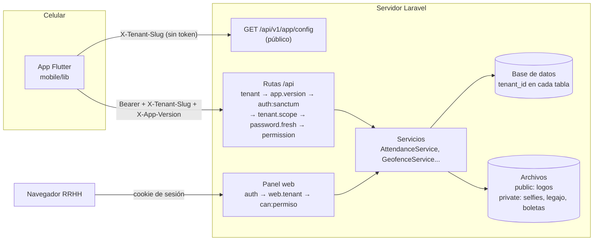

# Arquitectura general

TuneSA es un SaaS de RRHH **multi-empresa** (multi-tenant): una sola instalación de
Laravel atiende a muchas empresas y cada una solo ve sus propios datos. Tiene tres piezas:

| Pieza | Dónde está | Para quién |
|---|---|---|
| **API REST** (Laravel 11 + Sanctum) | `routes/api.php`, `app/Http/Controllers/Api/` | La app móvil (y Super Admin por API) |
| **Panel web** (Blade + Bootstrap, sesión) | `routes/web.php`, `app/Http/Controllers/Web/`, `resources/views/` | Super Admin, administradores, RRHH y supervisores |
| **App móvil** (Flutter) | `mobile/lib/` | Colaboradores (y supervisores/RRHH para su equipo) |

La lógica de negocio importante vive en servicios (`app/Services/`): `AttendanceService`
(marcación + bitácora inmutable `attendance_punches`), `GeofenceService` (distancia Haversine),
`Geocoding\GeocodingService` (Nominatim / Google), `Push\FcmSender` (push FCM),
`TenantSettingsService` (marca y app),
`LoginGuard` (bloqueo por fuerza bruta), `NotificationDispatcher`, `PayslipImportService`,
`DocumentStorageService`, `SecureFileUrl`, `AuditLogger`, etc.

## Diagrama

## Multi-tenant (aislamiento por empresa)

Cada tabla de negocio tiene `tenant_id`. El aislamiento se hace en capas:

1. **Resolver la empresa de la request.**
   - API: middleware `ResolveTenant` (alias `tenant`, `app/Http/Middleware/ResolveTenant.php`).
     Orden: cabecera `X-Tenant-Slug` → subdominio `empresa.<APP_DOMAIN>` (excepto `www`, `api`,
     `admin`, `app`, `mail`, `cdn`) → dominio propio (`tenants.custom_domain`) → `?tenant=` solo
     en entorno local. Si no encuentra empresa responde `404 TENANT_NOT_FOUND`; si está
     suspendida, `403 TENANT_INACTIVE`. También fija la zona horaria de la empresa.
     El tenant se cachea 5 minutos por slug/dominio.
   - Panel web: middleware `SetWebTenant` (alias `web.tenant`) activa la empresa del usuario
     logueado. Cierra el panel a quien no tenga `dashboard.view` o cuya empresa esté suspendida.
2. **`TenantContext`** (`app/Services/TenantContext.php`): singleton con la empresa resuelta.
   Helpers: `current_tenant()`, `current_tenant_id()`, `tenant_timezone()`.
3. **Global scope.** Los modelos con `tenant_id` usan el trait
   `App\Models\Concerns\BelongsToTenant`, que registra `App\Models\Scopes\TenantScope`
   (filtra toda consulta por la empresa del contexto), completa `tenant_id` al crear e impide
   guardar un registro de otra empresa (`DomainException`). Sin contexto (consola, seeders,
   vista global) el scope no filtra.
4. **`EnforceTenantScope`** (alias `tenant.scope`): segunda barrera en la API. Si el usuario
   del token no pertenece a la empresa resuelta responde `403 TENANT_SCOPE_VIOLATION`
   (y lo registra en el log). Super Admin pasa siempre.

Excepción a propósito: `TenantSetting` (tabla `tenant_settings`) **no** usa `BelongsToTenant`,
porque tiene una fila global con `tenant_id = NULL`. Filtra por `tenant_id` explícitamente.
Ver [white-label.md](white-label.md).

### Vista global del Super Admin

El Super Admin no pertenece a ninguna empresa. En el panel (`SetWebTenant::handleSuperAdmin`):

- Con una empresa elegida en el selector superior (`POST /admin/switch-tenant`, guarda
  `admin_tenant_id` en sesión) trabaja como si fuera de esa empresa.
- Sin empresa elegida está en la **vista global**: los listados muestran todas las empresas.
  Lo que crea registros pide elegir empresa primero (redirige con el mensaje "Para crear o
  editar, elige la empresa en el selector superior."), salvo las rutas permitidas en
  `GLOBAL_WRITE_ROUTES` y `GLOBAL_TENANT_PICKER_ROUTES` (sucursales y empresas eligen la
  empresa en el propio formulario; `settings.branding.update` edita los valores de la plataforma).

En la API, el Super Admin entra por `POST /api/superadmin/auth/login` (sin `X-Tenant-Slug`) y
administra empresas en `/api/superadmin/tenants` (crear, editar, suspender, activar).

## Roles y permisos

Roles (`users.role`): `super_admin`, `company_admin`, `hr_manager`, `supervisor`, `employee`.
La matriz está en `database/seeders/RolesAndPermissionsSeeder.php`:

| Rol | Permisos |
|---|---|
| Super Admin | todos (`*`) |
| Administrador de empresa | todos menos `tenants.manage` |
| RRHH | todos menos `tenants.manage`, `tenants.branding`, `company.configure`, `audit.view` |
| Supervisor | ver colaboradores/sucursales/turnos, marcar, ver asistencia propia y de su equipo, dashboard, reportes, pedir y aprobar solicitudes de su equipo, ver sus boletas, su legajo |
| Colaborador | ver sus turnos, marcar, ver su asistencia, pedir solicitudes, ver sus boletas, su legajo |

Cómo se exige:
- API: `->middleware('permission:x')` → `CheckPermission`, que responde
  `403 INSUFFICIENT_PERMISSION` con `required_permissions`.
- Panel: `->middleware('can:x')`; `AppServiceProvider` registra un `Gate::before` que usa
  `$user->hasPermission()`.
- El supervisor ve a los colaboradores de las sucursales donde es `branches.supervisor_id`
  (`User::visibleTo`).

Tras cambiar la matriz hay que re-sembrar: `php artisan db:seed --class=RolesAndPermissionsSeeder`.

## Módulos principales

| Módulo | API (app) | Panel | Notas |
|---|---|---|---|
| **Asistencia** con GPS + selfie | `/api/attendance/*`, `/api/v1/attendances/sync-batch` | `/attendance`, dashboard en vivo | Geocerca por sucursal (Haversine, `GeofenceService`). Política `reject` o `flag` por empresa. Anti-fraude: GPS simulado (`reject`/`flag`), precisión mínima, rostro, desfase de reloj, fuera de horario. Bitácora inmutable `attendance_punches` con motivos de sospecha, idempotencia por `client_uuid`, sincronización offline en lote. Ver [attendance-integrity.md](attendance-integrity.md) y [mobile-endpoints.md](../api/mobile-endpoints.md). |
| **Faltas** | — | `/attendance` | Comando `attendance:mark-absences`, programado a las 01:30 en `routes/console.php`; no marca nada en feriados y, si había una solicitud aprobada, registra el día como `excused` en vez de `absent`. |
| **Turnos** fijos y rotativos | `/api/my-shifts`, `/api/schedule` | `/shifts` | Tolerancia y refrigerio se proponen desde "Marca y app" > Reglas. |
| **Sucursales y geocercas** | `/api/my-branches` | `/branches` (mapa Leaflet) | El radio por defecto sale de "Marca y app" > Reglas. |
| **Solicitudes** (vacaciones, permisos, licencia médica) | `/api/leave-requests`, `/api/approvals/leave-requests` | `/approvals` | Licencia médica exige adjunto. Nadie aprueba sus propias solicitudes. |
| **Boletas** (PDF) | `/api/payslips` | `/payslips`, `/payslips/bulk` | Carga masiva: el DNI o código del empleado va en el nombre del archivo. Disco `private`. |
| **Legajo digital** | `/api/employee/documents`, `/api/employee/profile` | `/documents`, `/employees/{id}/file` | Archivos en disco `private`, URLs firmadas que vencen (`SIGNED_URL_MINUTES`). |
| **Dotación** (uniformes) | `/api/employee/uniform-sizes` | `/uniforms` | Exportación para logística. |
| **Planilla** | — | `/payroll` | Consolidado CSV. |
| **Notificaciones in-app + push** | `/api/notifications` | campana + `/notifications` | Se disparan desde eventos de modelos en `AppServiceProvider` (sirven para API, panel y cargas masivas) y desde la marcación (`attendance.outside_schedule`, `attendance.outside_geofence`). También salen por push FCM (`FcmChannel`) si la empresa tiene `fcm_enabled` y el usuario `fcm_token`. Ver [attendance-integrity.md](attendance-integrity.md#push-fcm). |
| **Geocodificación** | `/api/geocode/reverse` | `/geocode/search`, `/geocode/reverse` | Nominatim (1 req/s, caché) o Google con la clave de Marca y app. Completa la dirección de cada marcación en segundo plano. |
| **Feriados** | — | `/holidays` | Incluye carga de feriados de Perú. |
| **Auditoría** | — | `/audit` | `audit_logs` vía `AuditLogger`: revelado de cuentas, documentos vistos, marcaciones fuera de geocerca, sincronizaciones offline, cambios de "Marca y app". |
| **Marca y app** | `/api/v1/app/config`, `/api/admin/app-config` | `/settings/branding`, `/settings/mobile` | Ver [white-label.md](white-label.md). |

## Flujo de datos: de la app al panel

1. Al abrir, la app pide la configuración de su empresa (`GET /api/v1/app/config`) y el
   colaborador inicia sesión (`POST /api/auth/login` con `X-Tenant-Slug`). Recibe un token
   Sanctum que vence a los `MOBILE_TOKEN_DAYS` días (30 por defecto).
2. Para marcar, la app toma GPS y (si la empresa lo exige) la selfie, y envía un multipart a
   `POST /api/attendance/clock-in`. El backend:
   valida (`ClockInRequest`) → `AttendanceService::punch()`: devuelve el resultado existente si
   el `client_uuid` ya se usó → GPS simulado (rechaza o marca) / precisión baja / rostro →
   resuelve la hora si es offline → mide el desfase del reloj → guarda la selfie en WebP en el
   disco `private` → en una transacción: busca la sucursal vigente, calcula la distancia, aplica
   la política de geocerca, revisa la ventana del turno, calcula la tardanza, crea el registro
   en `attendances` y el evento inmutable en `attendance_punches` → después del commit:
   dirección del punto (job), avisos y, si la empresa configuró un webhook, un POST firmado
   `attendance.clock_in` (igual en descansos y salida). Los errores de regla salen como
   `AttendanceException` con su `code` (ver la API). La cola offline de la app puede enviar
   todo junto a `POST /api/v1/attendances/sync-batch`.
3. El panel lo ve al instante: el dashboard refresca con `GET /dashboard/live-stream`
   (sondeo JSON) y el visor `/attendance/{id}` muestra selfie (URL firmada), mapa y distancia.
   Las marcaciones aceptadas fuera del radio quedan con `within_geofence = false` y en auditoría.
4. Las decisiones de RRHH/supervisor (aprobar solicitud, revisar justificación o documento,
   publicar boleta) generan notificaciones in-app que la app lee en `GET /api/notifications`.

## Archivos

| Qué | Disco | Cómo se sirve |
|---|---|---|
| Logos, favicon, splash, avatares | `public` | `asset('storage/...')` → requiere `php artisan storage:link` |
| Selfies (`ATTENDANCE_DISK`), WebP desde esta versión | `private` (o S3) | URL firmada `/secure-files/selfie-in|selfie-out/{id}` (jornada) o `/secure-files/punch-photo/{id}` (cualquier evento, incluidos descansos), o prefirmada de S3 |
| Legajo (`DOCUMENTS_DISK`) | `private` (o S3) | URL firmada `/secure-files/document/{id}` |
| Boletas, sustentos de solicitudes y justificaciones | `private` | Descarga autenticada (`/api/payslips/{id}/download`, panel) |
